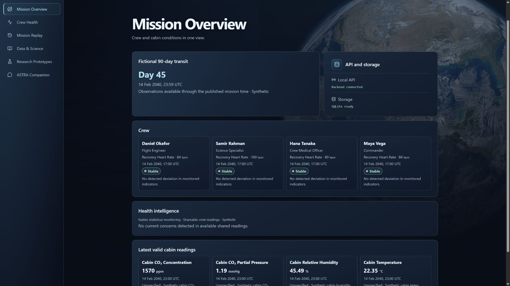
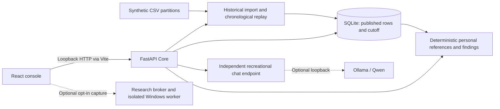

# ASTRA 2.0

**Autonomous Astronaut Health Intelligence**

Offline mission replay and explainable personal health monitoring for a simulated four-person spacecraft crew.



**Apache-2.0** · **Python 3.12** · **React + TypeScript** · **Offline Core** · **Synthetic mission data**

Long-duration missions bring communication delays, limited medical support, physiological adaptation, and a shared cabin environment. ASTRA explores what a crew could learn from its own readings and history using local computing. It is a research and engineering prototype for exploration and demonstration. It has no clinical validation or flight qualification.

| Screen | What you can do |
| --- | --- |
| **Mission Overview** | See the published mission time, four crew profiles, personal monitoring summaries, and cabin findings with evidence and uncertainty. |
| **Crew Health** | Compare a crew member’s readings with their own reference, inspect trends and supporting observations, and filter the charts by metric and range. |
| **Mission Replay** | Begin at the end of Day 45. Reveal the original recorded observations by timestamp or day, adjust playback speed, and reset to the historical cutoff. |
| **Data & Science** | Explore dataset provenance, NASA’s five spaceflight hazards, the statistical method, a hypothetical baseline comparison, and recorded verification. |
| **Research Prototypes** | Play synthetic facial and acoustic feature examples with no hardware. Optional Windows capture uses individual calibration and displays experimental feature deviations. |
| **ASTRA Companion** | Chat, play a text game, or ask for a quiz using an optional local Qwen model. The recreational assistant receives only the supplied conversation and has no access to health or mission records. |

More screenshots from the application on the same synthetic Day 45 mission: [Crew Health](docs/screenshots/crew-health.jpg), [Mission Replay](docs/screenshots/mission-replay.jpg), [Data & Science](docs/screenshots/data-and-science.jpg), [Research Prototypes](docs/screenshots/research-prototypes.jpg), and [ASTRA Companion](docs/screenshots/astra-companion.jpg). The captures contain synthetic mission information. Camera, microphone, and conversation content were excluded.

## Architecture



The backend owns the replay clock. It publishes exact source records in transactions and gates every observation query by the current UTC cutoff. Research sample results can appear beside Core findings as experimental cards. They do not set Core monitoring states. See [architecture](docs/ARCHITECTURE.md) and [API contracts](docs/CONTRACTS.md).

The Core stack is React 19, TypeScript 5.9, Vite, Tailwind CSS and Recharts on the frontend, with Python 3.12, FastAPI, Pydantic, and the Python standard-library SQLite driver on the backend. [Python lockfile](backend/uv.lock) · [npm lockfile](frontend/package-lock.json).

## Scientific method

ASTRA builds a fixed personal reference for each supported metric and context from Days 1–45. It uses daily medians and median absolute deviation, with metric-specific variability floors. Continuous comparisons use a modified Z-score where supported. Ordered self-reports use changes in reported categories. The engine checks recent direction, persistence, freshness and coverage. Context rules can bring together physiological, sleep, self-report, or cabin observations in defined time windows. A finding shows its evidence and a way to verify a reading. The configured thresholds describe unusual observations in this prototype. See the [health intelligence methodology](docs/HEALTH_INTELLIGENCE_METHODOLOGY.md).

## Dataset

**ASTRA-SYN-90D-01 v1.0.0** covers 90 fictional mission days, four fictional crew members and 18 metrics across activity, physiology, sleep, self-reports and cabin telemetry. The 12,491 original observations comprise 6,252 historical and 6,239 replay rows. Source quality flags identify 67 explicit missing observations across the complete bundle.

NASA Spaceflight Standard Measures informed the observation categories. A published astronaut sleep aggregate informed simulation checks. NASA’s cabin CO₂ brief and CDC/NHANES metadata supplied monitoring and measurement context. No individual astronaut records or individual NHANES data are included. The generator uses an explicit seed and illustrative distributions. The two source partitions remain visible to readers of the source tree, while the running application reveals records through its published replay cutoff. [Dataset guide](docs/DATASET.md) · [manifest](ASTRA_90day_dataset_v1/dataset_manifest.json) · [validation](ASTRA_90day_dataset_v1/validation_report.json) · [scientific sources](ASTRA_90day_dataset_v1/scientific_sources.csv).

## Start on Windows

Install [Git](https://git-scm.com/download/win), system-installed [Python 3.12](https://www.python.org/downloads/windows/), [uv](https://docs.astral.sh/uv/getting-started/installation/), and [Node.js](https://nodejs.org/en/download) 22.13+ in the 22.x line or Node.js 24+. The tested path uses Windows PowerShell and a local browser. The first installation needs registry access. Core runs over loopback after installation.

```powershell
git clone https://github.com/YelPa25/ASTRA-2.0.git
Set-Location .\ASTRA-2.0
```

Use the current private clone URL during release review. From the cloned root, open two PowerShell terminals.

**Terminal 1 · backend on port 8050**

```powershell
Set-Location .\backend
$astraPython = Join-Path $env:LOCALAPPDATA 'Programs\Python\Python312\python.exe'
uv sync --locked --python $astraPython --no-managed-python
uv run --locked --offline --python $astraPython --no-managed-python uvicorn --factory astra.main:create_app --app-dir src --host 127.0.0.1 --port 8050
```

If Python is installed elsewhere, set `$astraPython` to the full path of your installed Python 3.12 executable. FastAPI verifies the tracked runtime inputs and initializes backend/var/astra.sqlite3 on first start. A new database opens at the end of Day 45. Later starts reuse the database. No environment file is needed with the default paths and ports. [Configuration template](.env.example) · [Backend health](http://127.0.0.1:8050/api/health).

**Terminal 2 · frontend on port 5180**

```powershell
Set-Location .\frontend
npm.cmd ci
npm.cmd run dev
```

Open [ASTRA](http://127.0.0.1:5180/). Finish with Ctrl+C in each terminal.

1. Open **Crew Health** from Mission Overview and compare a measured reading with its personal reference.
2. Open **Mission Replay** and select **Next Day**. Return to the dashboard to see the new cutoff and readings. **Reset Replay** restores the Day 45 starting point.
3. Open **Data & Science** and move the hypothetical heart-rate slider to see how the same value compares with two personal baselines.
4. Play a synthetic **Research Prototypes** sample or start **ASTRA Companion** if the optional services are available.

### Optional Companion and research capture

Install [Ollama for Windows](https://ollama.com/download/windows) and pull the exact local model:

```powershell
ollama pull qwen3:4b-instruct-2507-q4_K_M
ollama list
```

Start Ollama and open Companion. On a Windows manual start, exit the Ollama tray application first if it owns port 11434, then set `$env:OLLAMA_NO_CLOUD = '1'` and run `ollama serve`. Verified with Ollama 0.40.16 on an RTX 5090 Laptop GPU. The model download is about 2.5 GB. GPU acceleration is optional for Ollama. Performance depends on available memory and hardware. [Model and license details](THIRD_PARTY_NOTICES.md#optional-local-runtimes-and-models).

Synthetic face and speech examples work after Core setup. The [Windows capture guide](docs/LIVE_RESEARCH_CAPTURE.md) covers the separate Python 3.11 CPU environment, model files, broker on port 8051, and camera and microphone permissions. Live capture requires separately obtained research dependencies and approved weights. Model files and private device data are excluded. See the [licensing and availability notes](THIRD_PARTY_NOTICES.md#optional-local-runtimes-and-models) before setting up capture.

## Project map

```text
backend/
  src/astra/                  Core API, SQLite, replay, statistics, and local chat
  tests/                      Core, replay, analysis, and Companion tests
frontend/src/                 React screens, charts, styles, and local assets
face_speech/                  Separate research integrations and detector tests
ASTRA_90day_dataset_v1/        Runtime partitions, metadata, and generator
docs/                         Architecture, methods, and verification records
```

| Path | Contents |
| --- | --- |
| [backend/src/astra](backend/src/astra) | API, SQLite, replay and observation queries. |
| [health_engine.py](backend/src/astra/health_engine.py) and [health_statistics.py](backend/src/astra/health_statistics.py) | Deterministic baselines and native monitoring. |
| [companion.py](backend/src/astra/companion.py) | Local Ollama interface, separate from mission data. |
| [frontend/src](frontend/src) | Six views, charts, interactions, and local visual assets. |
| [face_speech](face_speech) | Experimental feature extractors, detector, optional broker and tests. |
| [ASTRA_90day_dataset_v1](ASTRA_90day_dataset_v1) | Source runtime partitions, metadata, generator, validation and checksums. |
| [backend/tests](backend/tests) and [docs](docs) | Regression tests, methodology, and reproducibility notes. |

## Verification

From `backend`, after `uv sync` in the quick start:

```powershell
uv lock --check --offline --python $astraPython --no-managed-python
uv run --locked --offline --python $astraPython --no-managed-python pytest -q
uv run --locked --offline --python $astraPython --no-managed-python pytest -q tests/test_intelligence.py tests/test_intelligence_replay.py tests/test_science.py
uv run --locked --offline --python $astraPython --no-managed-python pytest -q tests/test_companion.py
```

From `frontend`, after `npm.cmd ci`:

```powershell
npm.cmd run lint
npm.cmd run typecheck
npm.cmd run build
```

Run the [research prototype tests](docs/FACE_SPEECH_RESEARCH.md#scope-and-startup) with the documented separate environment. The [verification report](docs/RELEASE_VERIFICATION.md) records what ran and distinguishes software and synthetic replay checks from device and model testing. The [Stage 04 evaluation](docs/STAGE_04_VERIFICATION.md) describes the full synthetic replay analysis. These checks do not establish clinical sensitivity or specificity.

## AI-assisted engineering

OpenAI ChatGPT supported concept development, scientific exploration, architecture and implementation planning, troubleshooting, critical review, documentation and design concepts. OpenAI Codex helped build and integrate the backend, frontend and statistical engine, debug and refactor software, add tests, manage Git, and prepare project documentation. The team set requirements, reviewed the work, and made the engineering decisions. Neither development tool nor the OpenAI API is a runtime dependency. Qwen is a separate optional model for local recreational chat.

## Scientific limits

ASTRA uses fictional crew and simulated measurements. Coverage varies by metric and time. The project-defined statistical thresholds have no clinical validation, the dataset contains no direct radiation measurements, and cabin associations do not establish causation. Facial and acoustic features are experimental and do not establish emotion, stress, or illness. ASTRA has no flight qualification or individual authentication. Use synthetic inputs for the demonstration purpose.

## Contributors and NASA Space Apps

Developed by the ASTRA team for the [2026 NASA Space Apps Challenge](https://www.spaceappschallenge.org/2026/), held November 14–15, 2026. The Git history and [research handoff notes](docs/FACE_SPEECH_RESEARCH.md) preserve contributor attribution. The project is an independent team submission.

## License and credits

Original team contributions are licensed under [Apache License 2.0](LICENSE). Upstream packages, models, and the Earth image retain their own terms. The backdrop is NASA’s [Blue Marble, 2012](https://www.nasa.gov/image-article/blue-marble-2012/), credited to NASA/NOAA/GSFC/Suomi NPP/VIIRS/Norman Kuring. See [third-party notices](THIRD_PARTY_NOTICES.md) for source links and restrictions.

## Team: Kernel_Panic
